# manisa_ulasim

Manisa için toplu taşıma uygulaması — yakındaki durakları bulma, hat/sefer arama, adım adım otobüs navigasyonu, şoföre bildirim, engelli kartı doğrulama ve yapay zeka destekli asistan içerir.

> **Not:** Bu repo, Manisa Büyükşehir Belediyesi'ne ait canlı API anahtarları ve veri kaynaklarını içermez (bkz. [Setup](#setup)). Aşağıdaki ekran görüntüleri uygulamanın gerçek API'lere bağlı haliyle çalışırken alınmıştır; bu repoyu klonlayıp kendi `.env` ve GTFS verileriniz olmadan çalıştırırsanız harita/hat/canlı veri özellikleri çalışmaz.

## Ekran Görüntüleri

| | | |
|---|---|---|
| 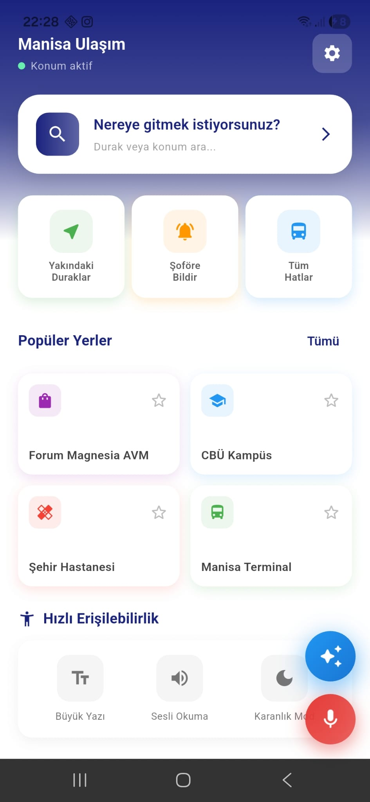 Ana ekran — durak/konum arama, hızlı erişim kısayolları ve popüler yerler | 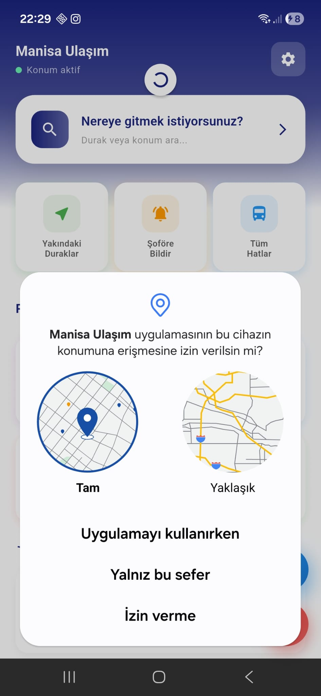 Konum izni isteği | 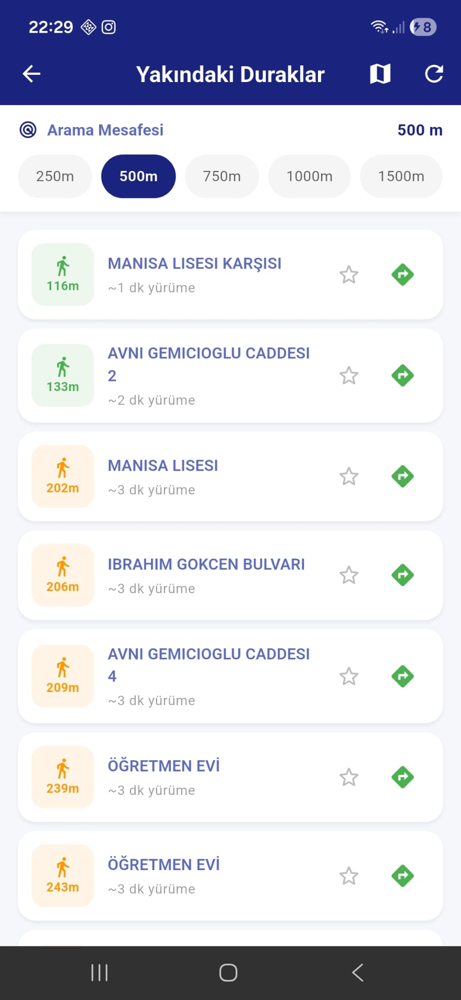 Yakındaki duraklar — mesafe filtresiyle liste görünümü |
| 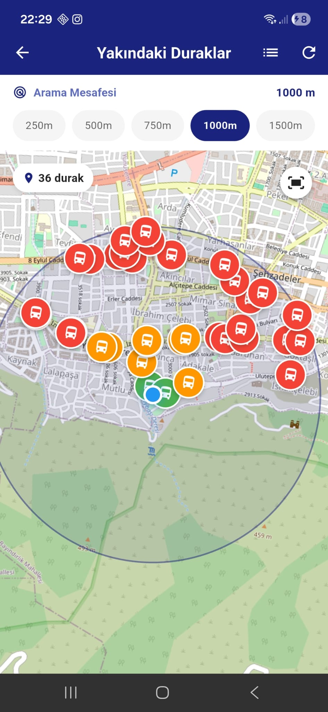 Yakındaki duraklar — harita görünümü | 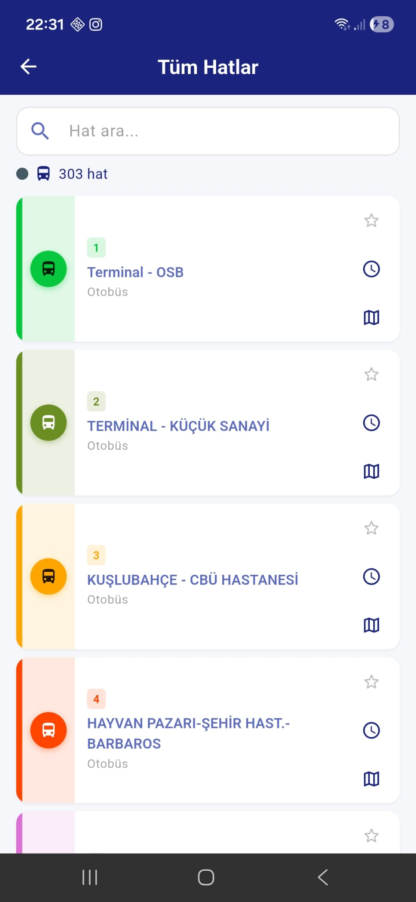 Tüm hatlar listesi | 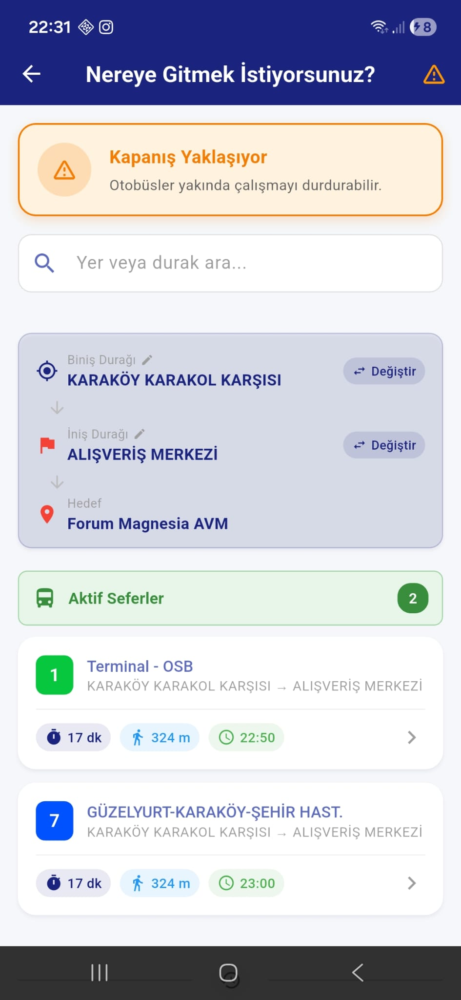 Rota planlama — biniş/iniş durağı seçimi ve aktif seferler |
| 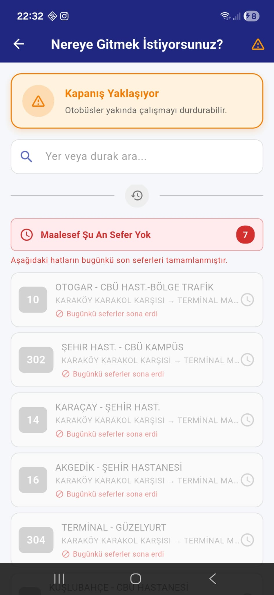 Günün son seferi tamamlanmış uyarısı | 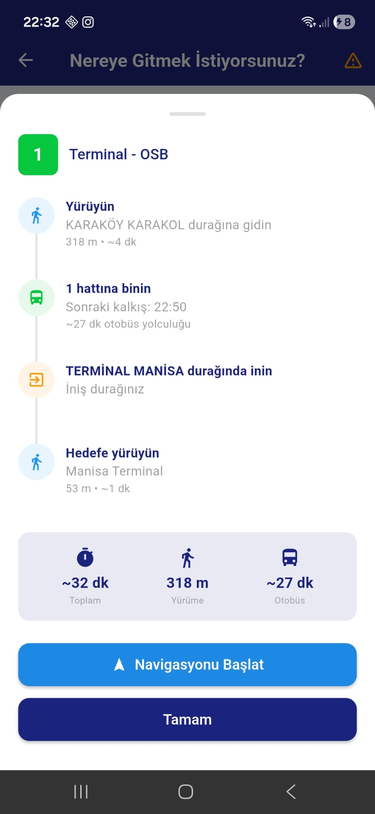 Adım adım yol tarifi (yürü → bekle → otobüs → iniş) | 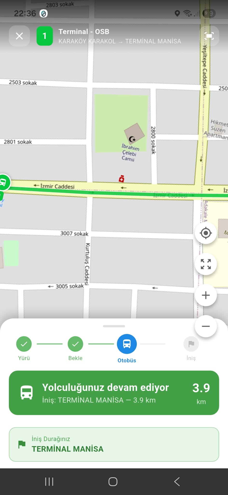 Canlı navigasyon — durağa yürüyüş aşaması |
| 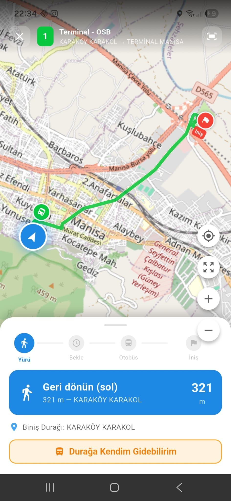 Canlı navigasyon — otobüs yolculuğu aşaması | 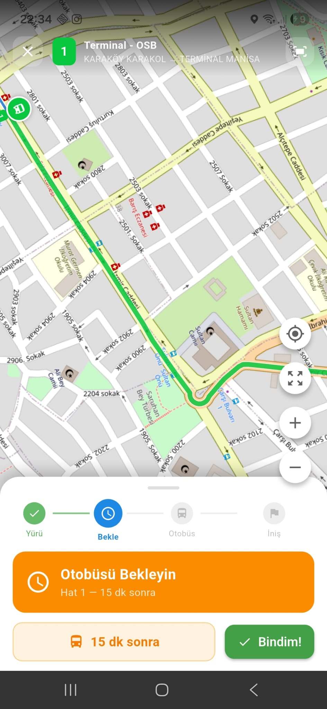 Otobüs bekleme ekranı ve "Bindim!" onayı | 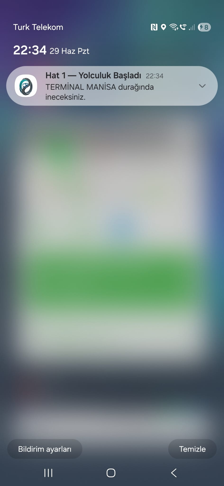 Yolculuk başladı bildirimi |
| 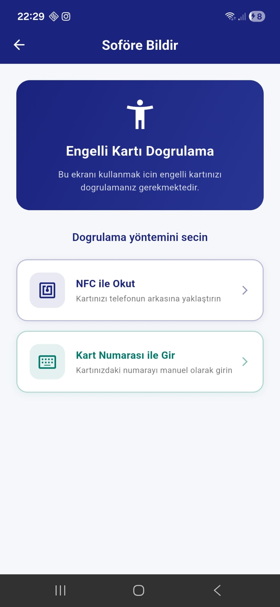 Şoföre Bildir — biniş/iniş durağı ve hat seçimi | 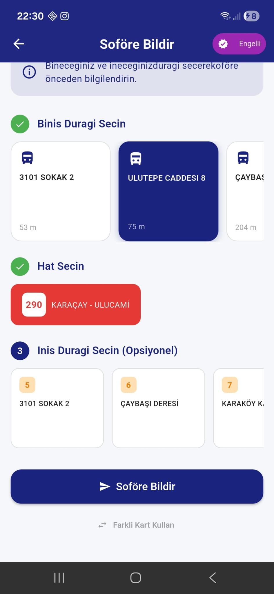 Engelli kartı doğrulama (NFC veya manuel kart numarası) | 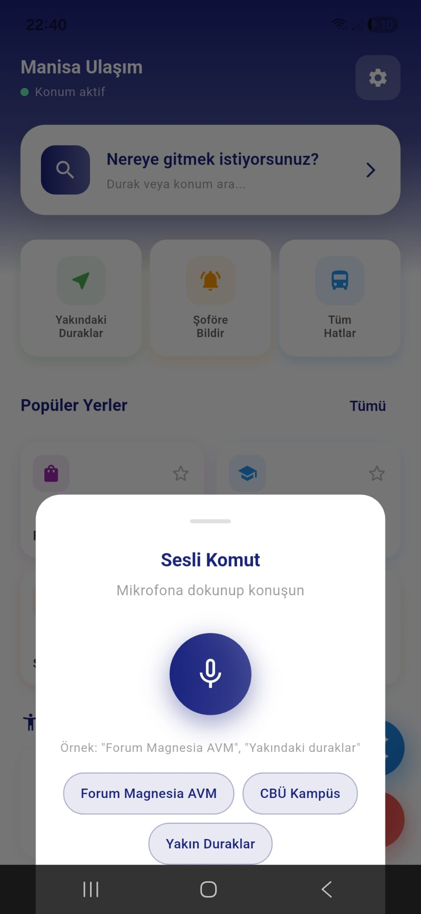 Erişilebilirlik — sesli komutla arama |
| 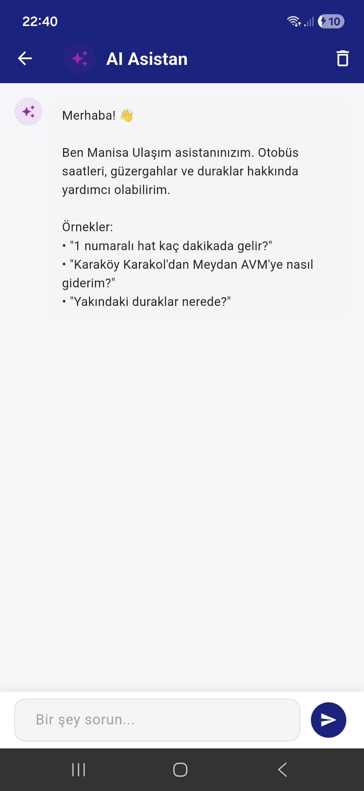 AI Asistan karşılama ekranı | 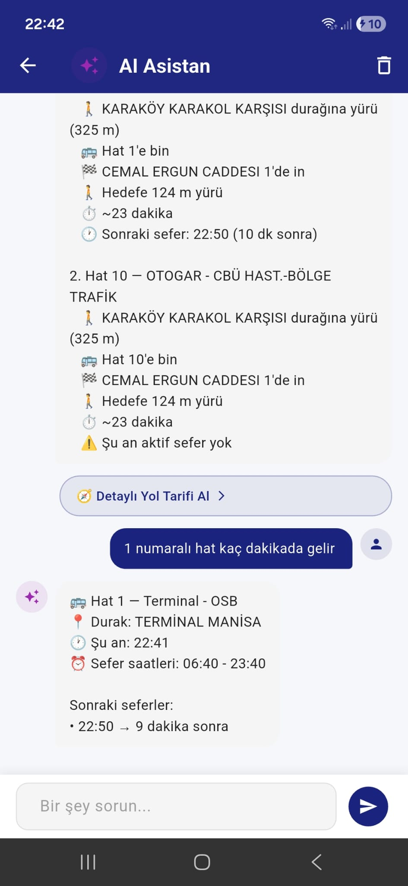 AI Asistan ile sohbet — hat ve sefer saati sorgulama | 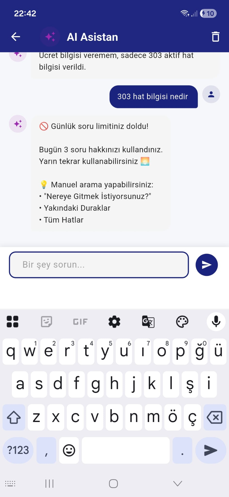 AI Asistan günlük soru limiti |
| 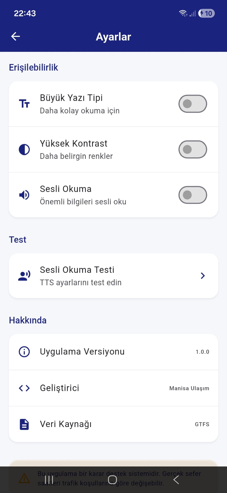 Ayarlar — erişilebilirlik seçenekleri ve uygulama bilgisi | 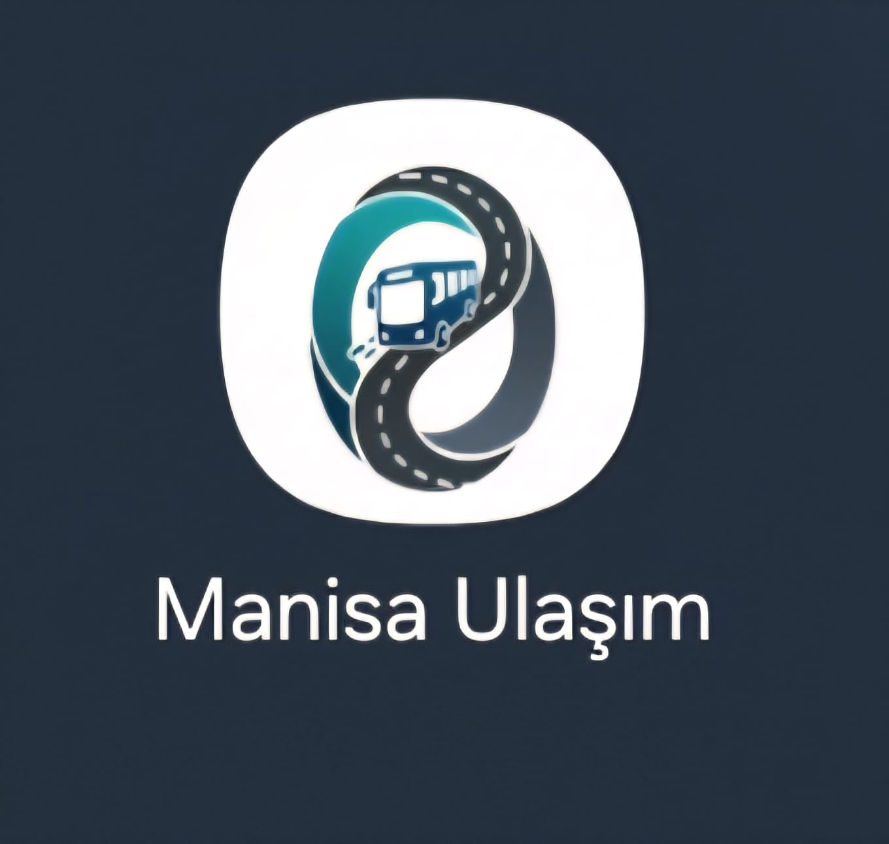 Uygulama ikonu | |

## Setup

1. Copy `.env.example` to `.env` and fill in your own values:
   - `GROQ_API_KEY` — Groq API key for the AI chat assistant.
   - `MANISA_API_BASE_URL` / `MANISA_BEARER_TOKEN` — terminal messaging API credentials (not included in this repo).
   - `MANISA_VEHICLE_API_BASE_URL` — live vehicle tracking API endpoint (not included in this repo).
   - `GROQ_API_URL`, `OSM_TILE_URL`, `OSRM_BASE_URL`, `GOOGLE_MAPS_DIRECTIONS_URL`, `GOOGLE_MAPS_SEARCH_URL` — public third-party service endpoints (OpenStreetMap, OSRM, Google Maps, Groq); defaults are provided in `.env.example` and can be used as-is.
2. Place your own GTFS feed files under `assets/data/` (Manisa) and `assets/gtfs/cyprus/` — these directories are gitignored since the bundled data belongs to Manisa Büyükşehir Belediyesi and is not redistributed here.
